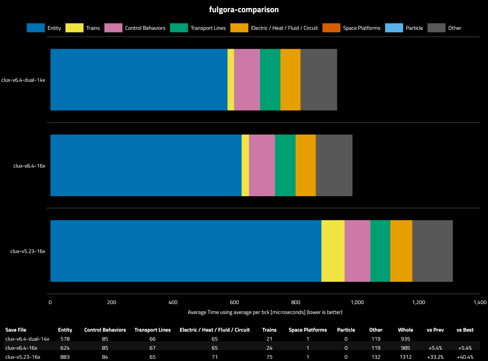
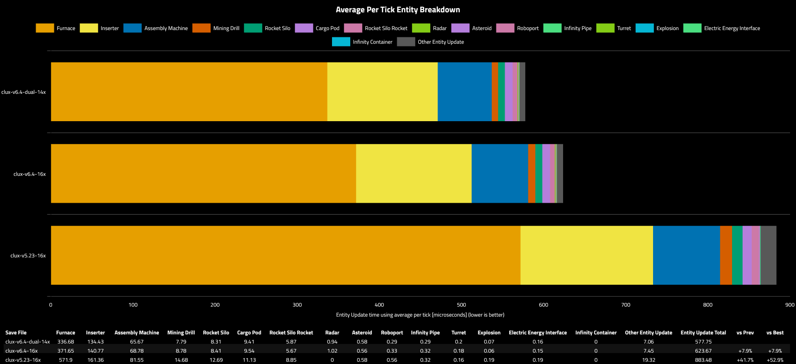
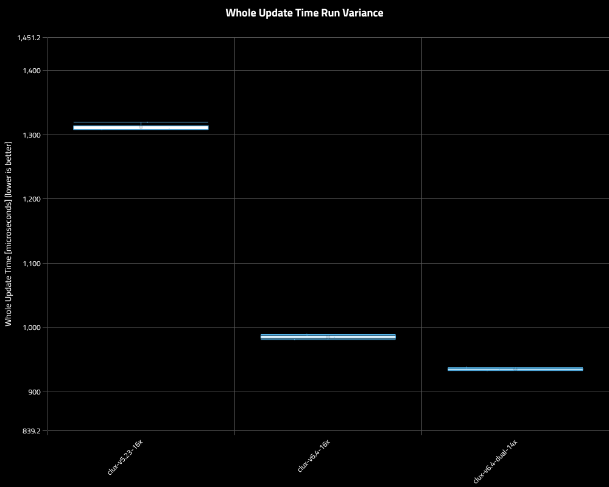
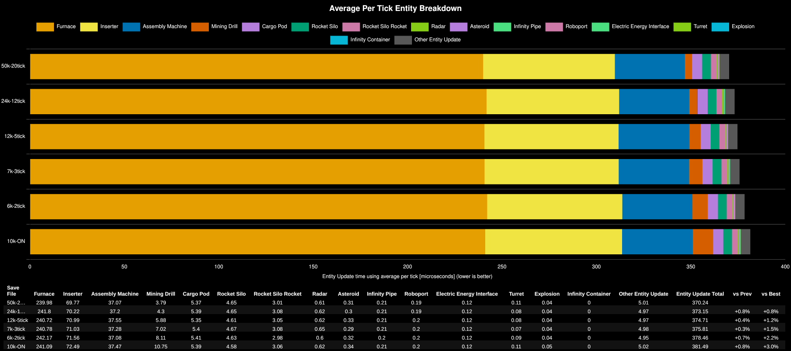

# v6 island bench

compares the two variants of v6 to v5.

overview;

entities;

run variance;

## Miner Effect
tests run at MP20k
this makes a marginal difference.

it was tested earlier here;

